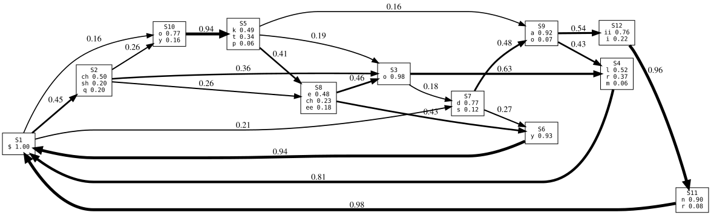

# 38 a 12-state machine for Currier A

| state | time spent | writes | next | stays | writes the space | main slot | share in main slot |
|---|---|---|---|---|---|---|---|
| S1 | 0.201 | $ 1.00 | S2 0.45, S7 0.21, S10 0.16 | 0.000 | 0.999 | 7: eee/ee/e | 0.000 |
| S2 | 0.108 | ch 0.50, sh 0.20, q 0.20 | S3 0.36, S8 0.26, S10 0.26 | 0.000 | 0.000 | 5: ch/sh | 0.701 |
| S3 | 0.103 | o 0.98 | S4 0.63, S7 0.18, S1 0.11 | 0.000 | 0.000 | 9: o/a | 0.511 |
| S4 | 0.098 | l 0.52, r 0.37, m 0.06 | S1 0.81 | 0.001 | 0.000 | 11: d/l/r/m/n | 0.506 |
| S5 | 0.082 | k 0.49, t 0.34, p 0.06 | S8 0.41, S3 0.19, S9 0.16, S6 0.12, S2 0.12 | 0.000 | 0.001 | 4: t/k/p/f | 0.910 |
| S6 | 0.072 | y 0.93 | S1 0.94 | 0.000 | 0.000 | 2: y/o | 0.465 |
| S7 | 0.070 | d 0.77, s 0.12 | S9 0.48, S6 0.27 | 0.001 | 0.000 | 1: q/s/d | 0.313 |
| S8 | 0.067 | e 0.48, ch 0.23, ee 0.18 | S3 0.46, S6 0.43 | 0.021 | 0.002 | 7: eee/ee/e | 0.674 |
| S9 | 0.065 | a 0.92, o 0.07 | S12 0.54, S4 0.43 | 0.000 | 0.000 | 9: o/a | 0.962 |
| S10 | 0.062 | o 0.77, y 0.16 | S5 0.94 | 0.012 | 0.000 | 2: y/o | 0.462 |
| S11 | 0.036 | n 0.90, r 0.08 | S1 0.98 | 0.001 | 0.000 | 11: d/l/r/m/n | 0.952 |
| S12 | 0.036 | ii 0.76, i 0.22 | S11 0.96 | 0.000 | 0.001 | 10: iii/ii/i | 0.999 |
