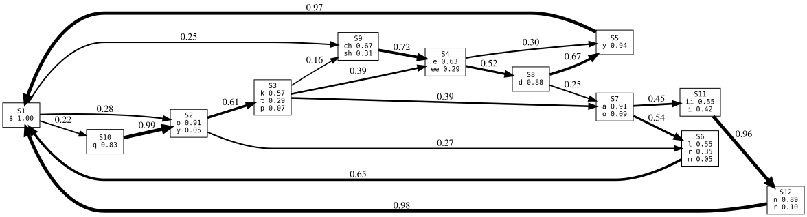

# 38 a 12-state machine for Currier B

| state | time spent | writes | next | stays | writes the space | main slot | share in main slot |
|---|---|---|---|---|---|---|---|
| S1 | 0.186 | $ 1.00 | S2 0.28, S9 0.25, S10 0.22 | 0.000 | 0.999 | 4: t/k/p/f | 0.001 |
| S2 | 0.109 | o 0.91, y 0.05 | S3 0.61, S6 0.27 | 0.001 | 0.000 | 2: y/o | 0.481 |
| S3 | 0.091 | k 0.57, t 0.29, p 0.07 | S4 0.39, S7 0.39, S9 0.16 | 0.000 | 0.000 | 4: t/k/p/f | 0.940 |
| S4 | 0.091 | e 0.63, ee 0.29 | S8 0.52, S5 0.30, S2 0.13 | 0.000 | 0.001 | 7: eee/ee/e | 0.937 |
| S5 | 0.090 | y 0.94 | S1 0.97 | 0.000 | 0.000 | 2: y/o | 0.485 |
| S6 | 0.087 | l 0.55, r 0.35, m 0.05 | S1 0.65 | 0.002 | 0.000 | 11: d/l/r/m/n | 0.503 |
| S7 | 0.082 | a 0.91, o 0.09 | S6 0.54, S11 0.45 | 0.000 | 0.000 | 9: o/a | 0.952 |
| S8 | 0.076 | d 0.88 | S5 0.67, S7 0.25 | 0.002 | 0.000 | 1: q/s/d | 0.300 |
| S9 | 0.074 | ch 0.67, sh 0.31 | S4 0.72, S8 0.12 | 0.000 | 0.000 | 5: ch/sh | 0.984 |
| S10 | 0.040 | q 0.83 | S2 0.99 | 0.000 | 0.000 | 1: q/s/d | 0.849 |
| S11 | 0.037 | ii 0.55, i 0.42 | S12 0.96 | 0.000 | 0.000 | 10: iii/ii/i | 0.999 |
| S12 | 0.036 | n 0.89, r 0.10 | S1 0.98 | 0.000 | 0.000 | 11: d/l/r/m/n | 0.946 |
