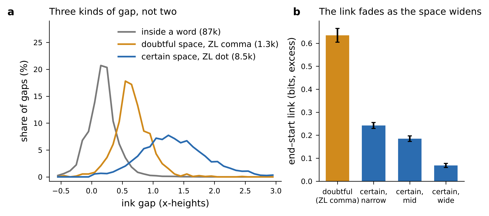

# 66 — Spaces measured letter by letter

## Why

Exps. 55 and 57 measured spaces with word boxes and with ink masks, but had to guess where inside a
line each transcribed boundary falls (I laid glyphs out as if all were equally wide). Ryan Allen's
glyph map (ryanallen.com/voynich, CC BY 4.0, snapshot of 22 November 2026) ties the ink of every
letter to the pixels of Yale's photographs, so every gap can be measured directly: between two
letters of a word, at a ZL doubtful space and at a ZL certain space. The map keeps ZL's doubtful
spaces (commas) inside its words, so those can be found too. Daniil Vaino pointed me to the data.

Most of the map is machine work: 333 words were traced by Ryan Allen himself, 127 settled by hand,
and the rest were placed or drafted by his models. For the certain spaces I use only the
machine-drafted words ('auto', 'auto-checked'). In the 'auto-placed' ones 31% of neighbouring words
overlap in the ink, which looks like placement error.

## How

Only ink within ±0.6 x-heights of the line's centre counts (x-height and centre: median box height
and centre of *o, a, e, y* on the line), so gallows stems and tails don't fill the gaps. Gap =
distance between the ink of the two units, in x-heights. Pairs inside benches (*c/s* + *h*, gallows
+ *h*) are left out of the letter gaps. The link across a boundary is the mutual information between
the end of one word and the start of the next, minus its mean with the pairs shuffled. It is compared
at equal n (1,304 pairs, 20 subsamples).

## Result

| | n | median gap (x-heights) | 10th-90th percentile |
|---|---|---|---|
| letters inside a word | 87,363 | 0.17 | −0.13 to 0.45 |
| doubtful space (ZL ',') | 1,304 | 0.64 | 0.33 to 1.00 |
| certain space (ZL '.') | 8,461 | 1.36 | 0.72 to 2.35 |

| boundary | link (bits) |
|---|---|
| doubtful space | 0.64 |
| certain space, narrowest third (median 0.87) | 0.24 |
| certain space, middle third (1.36) | 0.19 |
| certain space, widest third (2.00) | 0.07 |

The same fall holds inside each language: A 0.17 → 0.12 → 0.03, B 0.37 → 0.27 → 0.13. The qo- rhythm
of exp. 62 barely changes with width (after *ch/sh-…-y*: 1.78, 1.76, 1.66 times the base rate).

## So what

1. **There are three kinds of gap, not two.** The transcribers' doubtful spaces aren't a mix of
   spaces and non-spaces. They form their own population, about four times a gap between letters and
   half a space. Exp. 57 saw them as narrower spaces. With letters measured one by one they are a
   separate size the scribe made.
2. **The link between neighbouring words lives in the narrow spaces.** Across a doubtful space the
   end and the start are tied as tightly as letters inside a word. Across the widest third of the
   real spaces, almost nothing is left (0.07 bits, 0.03 in A). Boxes (exp. 55) and ink (exp. 57)
   showed the same direction. Here it is clean, with no guessing of positions.
3. **The rhythm doesn't care about width.** The family habit of exp. 65 (after *-y* comes *qo-*)
   crosses even the widest spaces almost unchanged. So there are two separate things. One is glyph
   coupling, which belongs to narrow spaces and looks like how the pen ran on. The other is the
   choice of the next word's family, which works on whole words.
4. Wide gaps inside words are rare (4%), most often between *q* and *o* (8% of those pairs). There's
   no hidden fourth class of unmarked spaces.

## Caveats

- Most tracings are machine work, not checked by a person. The pattern doesn't depend on that,
  but single values could.
- Lines whose words wrap around drawings can give long "spaces" that are layout, not writing. They
  sit in the widest third.
- 8% of matched words have readings that differ from ZL (corrections in the map). They are left out
  of the doubtful-space part only.
